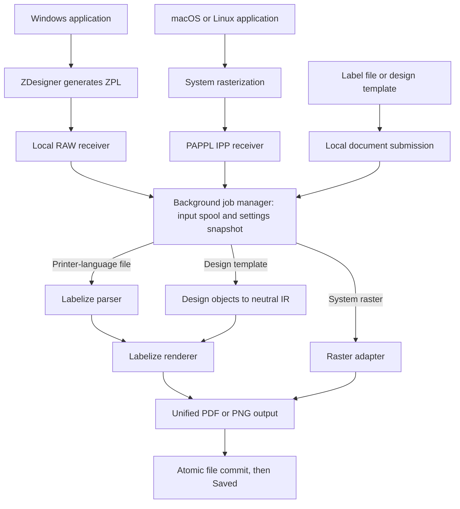
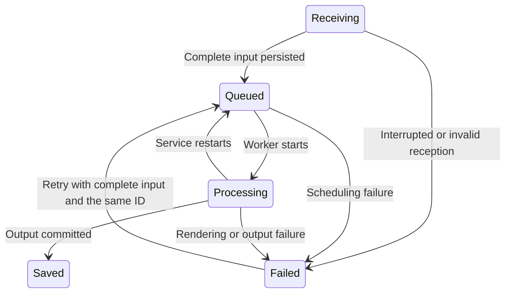

# Architecture

[README](README.md) · [Development guide](DEVELOPMENT.md) · [Acceptance record](ACCEPTANCE.md)

Labelize Printer separates input acquisition, job management, rendering, and file output. Printer-language files use Labelize; system raster pages are already laid out and go directly through raster adaptation and file encoding. LPrint is not a dependency.

## Data flow

## Component responsibilities

| Component | Responsibility |
| --- | --- |
| `crates/desktop` | GPUI setup, output settings, recent jobs, file editing, visual design, and preview controls. |
| `crates/daemon` | RAW reception, authenticated local IPC, job scheduling, isolated render workers, and the PAPPL process lifecycle. |
| `crates/core` | Settings, SQLite persistence, input snapshots, typed job boundaries, platform integration, document rendering, and output commits. |
| `native/ipp` | PAPPL job/page callbacks, raster validation and normalization, copy expansion, and reporting completion after files are saved. |
| `vendor/labelize` | Pinned language parsers, barcode encoders, and renderer. See [provenance](vendor/labelize/PROVENANCE.md). |
| `platform` / `scripts` | System queues, login services, native builds, icons, and installers. |

Within core, `document` dispatches label files to the appropriate parser and renderer. `design` turns visual objects and Labelize barcode output into language-neutral IR. `output` accepts normalized pages and commits PDF/PNG files. Operating-system integration and job management stay outside the Labelize dependency.

## Input boundaries and copies

### Windows RAW

The official ZDesigner driver produces ZPL and sends it through the system queue's local TCP port. The daemon commits a complete job only after a normal connection EOF. Network packets, newlines, and individual `^XZ` commands do not define job boundaries.

Timeouts, connection resets, empty connections, and oversized input fail the job. Received input is retained for diagnosis; incomplete jobs are not rendered.

### macOS and Linux IPP

The system queue sends PWG or Apple Raster to PAPPL, which handles IPP lifecycle and raster-protocol decoding. The C adapter validates page dimensions, row counts, and formats, then normalizes 1/8-bit K/W/SW and 8-bit-per-channel sRGB into grayscale PGM. It preserves pixel dimensions, physical size, orientation, and page order without further layout, scaling, or rotation.

The bundled PAPPL patch preserves client raster headers and accepts sRGB input that CUPS can produce for a monochrome queue.

If `job-pages-per-set` indicates that the client already expanded copies, the adapter validates the complete page count and keeps that order. Otherwise it expands IPP `copies` once, supporting collated and uncollated output. Labelize handles ZPL `^PQ` expansion. The output module has no copy-count parameter.

### Direct documents

`SubmitDocument` takes a language or design-template type and a per-job settings snapshot. The daemon copies the input into its private job directory before responding, so the job no longer depends on the original file or the desktop process. Workspace settings do not overwrite system-queue settings.

The legacy `Zpl` input representation remains supported for RAW and previously stored jobs. Other printer-language copy semantics follow the embedded Labelize engine; the integration does not add its own expansion for those languages.

## Persistence and recovery

A `JobRecord` and settings snapshot are created when a RAW connection opens or an IPP raster job begins. IPP first calls `begin-raster` to obtain a UUID, then submits a manifest with that UUID. Settings changed during a long reception do not affect the job already being received.

SQLite uses WAL mode and FULL synchronization. Input is written to private application storage and synced before the job is queued. The database records state, source, settings, page count, output files, errors, and retry attempts. Receiving all bytes is distinct from saving the output.

Each rendering job runs in a separate process without GUI or GPU initialization, with a 300-second timeout. An exclusive job-file lock prevents two workers from writing the same task after a restart. Output is written into a hidden temporary directory on the destination filesystem, then the whole directory is committed by rename. A completion receipt allows recovery if the process exits after the files are committed but before SQLite records success.

On restart, `Processing` jobs return to `Queued`; incomplete `Receiving` jobs become `Failed`. Retries reuse the UUID and original settings. Fixing the original output directory's permissions enables retry; changing global settings does not silently redirect an existing failed job.

PAPPL's end-job callback waits for actual output success. It returns success only after the output files are committed; failures report an aborted IPP job. The daemon restarts PAPPL after a crash, and interrupted receptions fail and require resubmission. A parent-process check terminates the adapter when its daemon exits.

If staging fails before an error manifest can be written, the adapter also reports the failure over IPC. A completely full database disk can prevent even the failure state from being recorded; logs are retained, and restart recovery applies after space is freed.

## Internal types

| Type | Boundary |
| --- | --- |
| `PrintJobInput::Zpl` | Private ZPL input file; resolution and fallback dimensions come from the job's settings snapshot. |
| `PrintJobInput::LabelFile` | File language or design-template type, private input snapshot, and independent job settings. |
| `PrintJobInput::RasterPages` | Final page order, with per-page file, physical size, and resolution. |
| `RenderedPage` | Grayscale pixels, pixel dimensions, physical dimensions, and X/Y resolution. |
| `JobRecord` | UUID, settings snapshot, input, state, output locations, and diagnostics. |
| `OutputReceipt` | Committed files and page count used to recover completion. |

ZPL parsing uses `parse_with_options` to enable declared dimensions, complete-format validation, and a 1,000-label limit. The original parser API keeps its default behavior. Valid `^PW` and `^LL` dimensions take precedence over fallback settings. `^LL` takes effect before the first `^FS`; later changes apply to the next label.

## Desktop previews and designs

`core::document::render` is shared by preview and export, including page order, dimensions, and canvas limits. The desktop starts the daemon's standalone `preview` subcommand with a 300-second timeout. That process writes PNG pages and page metadata; the desktop decodes display images off the UI thread, serializes decoding, and cancels obsolete page loads. It holds one display image bounded to 2048 × 2048 pixels and at most five 120 × 176 thumbnails. Full-resolution preview files remain on disk. Inactive and closed tabs explicitly evict their GPU textures. Temporary preview directories are owned by the desktop and cleaned up when their handles are dropped.

`desktop::workbench` owns independent `Studio` document entities. Editors, selected objects, undo history, revisions, page selection, and export options belong to a document, while queue setup and defaults remain application-level settings. File loading, saving, preview rendering, and job submission have separate states.

Text/property changes debounce for 500 ms. `preview_queue` runs at most one child, kills and reaps cancelled renderers, and prioritizes the active document. Request IDs are separate from content revisions, so a cancelled callback cannot invalidate a new preview at the same revision. Rendering and callbacks never reset input focus. Exports use a fresh payload/settings snapshot and return to editing after `SubmitDocument` durably accepts the job; completion polling is independent of preview caches.

`session` stores a versioned workspace manifest and immutable, SHA-256-addressed draft/source blobs under the user's private `workspace` directory. Raw input fields are captured without requiring successful rendering or validation. After one second of inactivity, drafts are written before the manifest is atomically replaced. The previous complete generation remains available for recovery; unreferenced blobs are then collected. Monotonic save sequences and a mutex serialize autosaves with the close-time flush. Corrupt manifests fall back to the previous generation, and a damaged draft does not discard other valid tabs. Recovery warnings require acknowledgement and archive the original workspace before replacement. Disk write failures keep the window open with a retry action.

Source files are separate from local drafts. Save checks the digest of the last loaded/saved source before replacement, prompts on external modification or removal, and clears the unsaved indicator only if the saved revision is still current. Save cancellation retains the tab. UI settings (`desktop.json`) stay compatible with existing language-only preferences.

Design format version 1 stores up to 100 objects in `.labelize.json`: geometry in millimetres, text and barcode content, images, and an optional imported font. Images and fonts are embedded as base64 data, without external file dependencies. Undo history is bounded by both entry count and asset size.

Images are composited over white. Barcodes use integer module scaling and quiet zones. Missing font glyphs, overflowing text, invalid geometry, and barcodes that cannot fit are rejected. Preview and export apply the same rules. Designs produce neutral IR directly; they are not converted to ZPL. Importing printer-language source does not reconstruct visual objects.

## Local communication and lifecycle

Application storage and Unix IPC parent directories use mode `0700`; socket and token files use `0600`. Windows named pipes have an explicit DACL for the current user's SID. IPC requests also carry a token from private storage.

RAW and IPP listen only on IPv4 loopback. RAW itself has no user authentication, which is a limitation of the current local, single-user scope. Network sharing is not supported.

Queue setup first attempts the user's existing permissions, then requests macOS authorization or Linux PolicyKit elevation if needed. Windows queue scripts elevate when required. Routine processing is not elevated. Setup refuses to replace an unrelated printer or port with the same name.

Login startup uses a Windows scheduled task, macOS LaunchAgent, or Linux user-level systemd service. Closing GPUI leaves the daemon running; `stop` requires an idle queue. After queue installation, a port conflict is reported instead of silently changing ports and disconnecting the system queue. The user must resolve the conflict and repair the queue.

## Resource limits and retention

| Resource | Limit |
| --- | --- |
| Job input | 64 MiB; raster input is counted after normalization and copy expansion. |
| Pages per job | 1,000 |
| Page canvas | 16 Mi pixels, at most 32,000 dots on either axis. |
| Worker time | 300 seconds |
| Preview cache | 128 Mi pixels across all pages. |
| Design objects | 100 per template. |
| Embedded assets | 8 MiB per image and 32 MiB per font; the complete document also obeys the input limit. |
| Concurrent reception | 4 RAW connections and 16 IPC handlers. |
| Output workers | One at a time. |

Dimensions and resolutions must be finite and valid. Jobs must be self-contained; fonts, graphics, and stored formats are not cached across tasks. Inputs, diagnostics, and completed history are retained locally, and user output is not automatically deleted. Disk quotas and history cleanup are future work; monitor data-directory usage during trials.

## References

- [PAPPL raster printing callbacks](https://www.msweet.org/pappl/pappl.html#the-raster-printing-callbacks)
- [PAPPL 1.4.12 source](https://github.com/michaelrsweet/pappl/releases/tag/v1.4.12)
- [Zebra ZPL Programming Guide](https://www.zebra.com/content/dam/support-dam/en/documentation/unrestricted/guide/software/zpl-zbi2-pg-en.pdf)
- [OpenSSL source releases](https://www.openssl-library.org/source/)
