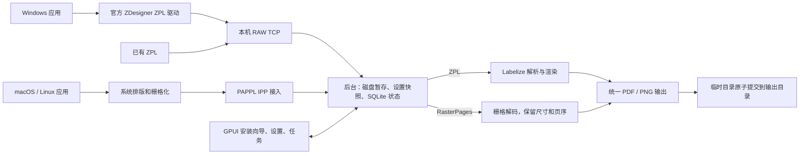

# Labelize Printer

独立的 Rust + GPUI 本地虚拟打印机，复用 Labelize，将打印任务保存为多页 PDF 或逐页 PNG。
首版面向当前登录用户、单台计算机、单队列。无需云端服务。



| 模块 | 职责 |
|---|---|
| `crates/desktop` | GPUI 原生界面、目录选择、设置、安装/修复队列、任务和重试 |
| `crates/daemon` | RAW 接收、认证 IPC、任务调度、独立渲染子进程、PAPPL 生命周期 |
| `crates/core` | 配置和 SQLite、输入暂存、类型边界、平台管理、文件输出 |
| `native/ipp` | PAPPL 的任务/逐页栅格回调，规范化 PGM、份数展开、等待实际保存结果 |
| `vendor/labelize` | Labelize 库的固定源码快照；仅 ZPL 路径调用，来源见 [PROVENANCE](vendor/labelize/PROVENANCE.md) |
| `platform` / `scripts` | 系统队列、登录服务、构建与安装包 |

**LPrint 不在依赖中。** 系统栅格直接进入文件输出，不往返转换为 ZPL。
更多任务协议与恢复行为见 [ARCHITECTURE.md](ARCHITECTURE.md)。

## 运行

需要 Rust 1.99、C 编译器、pkg-config、Python 3.11+。macOS 需要 Command Line Tools；
启用 GPUI `runtime_shaders`，无需离线编译 Metal 着色器。Linux 构建依赖见
[linux.Dockerfile](scripts/linux.Dockerfile)。
固定的 GPUI 源码带有本应用的 X11 兼容补丁，详情见 [GPUI patch](vendor/gpui/PATCH.md)。

```bash
cargo build --workspace --locked
# macOS/Linux：构建固定 OpenSSL 和 PAPPL 适配器
bash scripts/build-openssl.sh
bash scripts/build-native.sh
target/debug/labelize-printer
```

打开应用，选择输出目录和分辨率，然后点击「添加打印机」。需要管理员权限时，
使用系统授权提示。日常接收、渲染和保存以登录用户权限运行。关闭 GPUI 窗口不会停止后台。
向导的「保存并测试输出」使用当前表单设置提交测试任务，并打开最近任务。
用 Ctrl+1/2/3（macOS 为 Cmd+1/2/3）切换三个页面，用 Page Up / Page Down 滚动内容。

默认 PDF、文档目录中的 `Labelize`、102 × 152 mm、8 dpmm。
每个任务在输出目录中创建 `时间_任务ID/`，里面是一份 PDF 或带页码的 PNG。
整个目录一次提交，避免一组 PNG 只保存了一半却显示成功。

### Windows

安装 Zebra 官方 ZDesigner v10 的 **ZD421 ZPL 203 dpi 或 300 dpi** 驱动，
在安装向导点击“刷新检测”并选择相应驱动。程序创建 `LabelizePrinter_RAW` 本地 TCP 端口
和 `LabelizePrinter` 队列。RAW 监听地址始终为 `127.0.0.1`。

在 ZDesigner Driver Settings 中将 Status checking 禁用；本产品不模拟硬件状态回读。
驱动纸张、分辨率应与向导一致（203→8 dpmm，300→12 dpmm）。
Windows Protected Print Mode 与第三方驱动不兼容；程序检测并报告，不修改该策略。

[官方驱动下载](https://www.zebra.com/us/en/support-downloads/printer-software/printer-drivers.html)。
驱动不随安装包重新分发。真实驱动任务边界和输出兼容性须完成 [验收表](ACCEPTANCE.md) 后确认。

### macOS / Linux

内置 PAPPL 在本机 IPP 端口提供 `/ipp/print`；安装向导使用 `lpadmin -m everywhere`
注册名为 `Labelize Printer` 的队列。系统负责将应用页面转换为 PWG/Apple Raster。
接收后保留页面像素、分辨率及物理尺寸，不再次排版、缩放或旋转。

Linux 需要运行 CUPS 和桌面 PolicyKit agent；Wayland 目录选择需要可用的 xdg-desktop-portal。
登录服务分别使用 LaunchAgent、用户级 systemd、Windows 登录计划任务。
自动启动设置在下次登录生效，当前后台保持运行。

### 命令行 / 已有 ZPL

```bash
target/debug/labelize-printer-daemon serve
target/debug/labelize-printer-daemon submit label.zpl --wait
target/debug/labelize-printer-daemon status
target/debug/labelize-printer-daemon test-print --wait
target/debug/labelize-printer-daemon retry TASK_UUID --wait
```

`serve` 常驻；其他命令通过当前用户 IPC 操作后台。GUI 会自动启动后台。
`--data-dir /absolute/path` 或 `LABELIZE_PRINTER_HOME` 可隔离开发/测试数据。
`settings` 输出配置 JSON，`settings --file config.json` 保存。
`watch` 输出任务快照，`refresh` 重新检测驱动与队列。
`uninstall` 移除队列及本用户登录服务，`stop` 在任务空闲时停止后台。
已保存文件与失败输入不会在卸载时删除。

## 构建安装包

```bash
cargo build --workspace --release --locked
bash scripts/build-openssl.sh
bash scripts/build-native.sh release
python3 scripts/collect-licenses.py
bash scripts/package-macos.sh   # macOS 原生架构 PKG
bash scripts/package-linux.sh   # Debian 12 x64 环境生成 DEB
```

Windows 原生 MSVC 构建后，运行 `python scripts/collect-licenses.py` 和
`makensis platform/windows/installer.nsi`。输出均在 `dist/`。
交叉编译 `x86_64-pc-windows-gnu` 调试包需要 MinGW 的 `gcc` 和 `windres`，后者用于嵌入应用图标和清单。
修改 `platform/icon.svg` 后，可在配有 ImageMagick 的 macOS 上运行 `bash scripts/build-icons.sh`
重新生成 GPUI、Windows 和 macOS 的图标文件。
CI 为 Windows、两种 macOS 架构和 Debian 12 生成试用包；CI 配置本身不代表这些平台已经验收。
当前实际执行记录在 [ACCEPTANCE.md](ACCEPTANCE.md)。

PKG 使用 ad-hoc 应用签名，安装包没有公开发行签名或公证。
安装后第一次打开应用完成本用户队列设置。升级前先退出 GPUI 并运行 `daemon stop`，
升级不删除数据库、原始输入或输出。卸载前在应用中移除队列，再停止后台并移除应用包。

## 验证

```bash
cargo test -p labelize-printer-core
python3 scripts/smoke.py                    # 无系统队列变更的真实 RAW/IPP 测试
python scripts/smoke.py --skip-ipp          # Windows RAW 测试
cargo clippy --workspace --all-targets -- -D warnings
```

Debian 12 容器中的安装、CUPS 实际过滤/打印和卸载检查：

```bash
docker build --platform linux/amd64 -f scripts/linux.Dockerfile -t labelize-printer-build .
docker build --platform linux/amd64 -f scripts/linux-system.Dockerfile -t labelize-printer-system-test .
# 先按上面的步骤生成 dist/*.deb；脚本只允许在容器中运行。
docker run --rm --platform linux/amd64 -v "$PWD:/build" labelize-printer-system-test bash scripts/linux-system-smoke.sh
```

图形启动诊断可设置 `LABELIZE_PRINTER_DEBUG=1` 后从终端运行桌面程序，日志写入 stderr。

限制：64 MiB 输入、1000 页、每页最多 16 Mi 像素/32000 dots、渲染超时 300 秒。
ZPL 必须自包含，跨任务不保存字体/图形/格式。栅格暂存的 64 MiB 上限按规范化页面及展开后的份数计。
RAW 正常 EOF 才提交；TCP 分包、换行、单个 `^XZ` 均不代表完整任务。
“传输结束”和“文件已保存”是两个状态，只有最终文件提交成功才显示已保存。

公开发布签名、公证、网络共享、多用户隔离队列、跨任务资源缓存、矢量 PDF 不在本版范围内。
